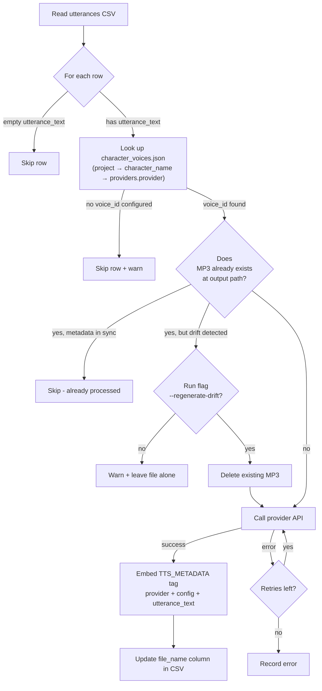

# Bitpart CLI

Bitpart is a command CLI for game-content automation. Today it ships with one subcommand:

- **`bitpart tts`** — converts utterance text from a CSV file to speech using the **ElevenLabs** or **Inworld** TTS API. Generates MP3 files and updates the the Bitpart CSV file.

> **Confused by any of the file formats below?** A complete, runnable pair plus copy-paste commands lives in [`examples/`](examples/) — see [`examples/README.md`](examples/README.md).

## Setup

1. **Create a virtual environment** (keeps packages in the project, avoids Windows long-path issues):
   ```powershell
   cd bitpart-cli
   python -m venv venv
   .\venv\Scripts\Activate.ps1
   ```
   Your prompt will show `(venv)` when it's active.

2. **Install dependencies** (with venv activated):

   Recommended (installs a real CLI command: `bitpart`):
   ```powershell
   pip install -e .
   ```
   This installs the dependencies **and** registers a `bitpart` console command that's runnable from any directory while the venv is active. The `-e` (editable) flag means edits to the source are picked up immediately, no reinstall needed.

   <details>
   <summary>Other install paths (test deps, fallback)</summary>

   To also install the test dependencies:
   ```powershell
   pip install -e ".[dev]"
   ```

   Fallback (deps only, no console-script shim — invoke with `python -m bitpart` instead):
   ```powershell
   pip install -r requirements.txt
   ```
   </details>

3. **Get an API key** for the provider you want to use:
   - ElevenLabs: sign up at [elevenlabs.io](https://elevenlabs.io) and create one at [API Keys](https://elevenlabs.io/app/settings/api-keys).
   - Inworld: sign up at [inworld.ai](https://inworld.ai) and grab a TTS API key.

4. **Set your API key** (any of these works):
   - Environment variable: `ELEVENLABS_API_KEY=your_key_here` and/or `INWORLD_API_KEY=your_key_here`
   - Or create a `.env.local` file in the **repo root** ( e.g. `C:\Github\bitpart-cli\.env.local`), auto-loaded if `python-dotenv` is installed:
     ```
     ELEVENLABS_API_KEY=your_key_here
     INWORLD_API_KEY=your_key_here
     ```

## Workflow

The utterances CSV (from Coppola) drives everything — it's the list of lines that need audio. `character_voices.json` is the per-character voice config that `bitpart tts` consults when generating those lines. Author the JSON before the first audio run, then iterate.

1. **Bootstrap `character_voices.json` from a CSV** (skip if you already have one):
   ```powershell
   bitpart tts "path\to\utterances.csv" --project Village --init --provider elevenlabs(or 'inworld')
   ```
   This scans the CSV, collects unique `character_name` values, and writes a skeleton `character_voices.json` with empty `voice_id`/`gender` you can fill in.

2. **Edit `character_voices.json`** and fill in `voice_id` for each provider you'll use, plus `gender` if helpful.

3. **Generate audio**:
   ```powershell
   bitpart tts "path\to\utterances.csv" --project Village --provider elevenlabs
   ```
   Equivalent without depending on PATH (works as soon as the package is installed):
   ```powershell
   python -m bitpart tts "path\to\utterances.csv" --project Village --provider elevenlabs
   ```

   In short: the script reads the CSV, for each row looks up `character_voices.json[<project>][<character_name>].providers[<provider>]`, calls the API, saves MP3s in the **same folder as the CSV** as `{character_id}_{utterance_id}.mp3`, and updates the `file_name` column in the CSV with the full path.

<details>
<summary>What happens under the hood (flow diagram)</summary>



</details>

In-game, the CSV is looked up by `utterance_id` + `character_name` to find `file_name`.

## CLI flags (`bitpart tts`)

| Flag | Description |
|---|---|
| `csv` (positional) | Path to the utterances CSV file (required). |
| `--project` | Top-level key in `character_voices.json` (e.g. `Village`, `Kelpie`). Required. |
| `--provider` | `elevenlabs` (default) or `inworld`. Selects which `providers.<...>` block to use. |
| `--init` | Scaffold/extend `character_voices.json` from the CSV and exit. No TTS calls. |
| `--regenerate-drift` | Delete and regenerate any existing audio whose embedded `TTS_METADATA` no longer matches the CSV `utterance_text` or any audio-affecting key in the JSON entry (see [Drift detection](#drift-detection) for the per-provider list). Without this flag, drift is reported as a warning and the files are left alone. |
| `--character-voices` | Override the path to `character_voices.json` (default: alongside the CSV, then the script directory). |
| `--output-dir` | Where audio files go (default: same folder as the CSV). |
| `--limit N` | Only process N utterances (handy for testing, e.g. `--limit 1`). |
| `--debug` | Print one line per file instead of a dot-per-file progress bar. Also surfaces per-row "Skipping - already processed" / "file exists, updating CSV only" lines for existing audio (silent in the default mode). |

## Configuration

### Environment variables

Bitpart environment variable naming are 

- **`BITPART_TTS_*`** is reserved for knobs that Bitpart owns for the `tts` subcommand.

**Precedence:** CLI argument > env var > built-in default.

| Environment Variable | Description |
|---|---|
| `ELEVENLABS_API_KEY` | Required for `--provider elevenlabs`. |
| `INWORLD_API_KEY` | Required for `--provider inworld`. |
| `INWORLD_MODEL_ID` | Optional. Default Inworld model (default: `inworld-tts-1.5-max`). Per-character `model_id` overrides this. |
| `BITPART_TTS_RETRY_COUNT` | Optional. Retries per row on provider failure (default: 2). Applies to all providers. |
| `BITPART_TTS_PROVIDER` | Optional. Default provider when `--provider` is omitted. Must be one of the supported providers (`elevenlabs`, `inworld`); invalid values exit with a clear error. |
| `BITPART_TTS_CSV_UTTERANCE` | Optional. Default path to the utterances CSV when the positional `csv` argument is omitted. |
| `BITPART_TTS_OUTPUT_DIR` | Optional. Default for `--output-dir`. If neither flag nor env is set, audio is written next to the CSV. |
| `BITPART_TTS_CHARACTER_VOICES` | Optional. Default path to `character_voices.json` when `--character-voices` is omitted. Falls back to "alongside the CSV", then repo root. |
## `character_voices.json` format

One JSON file holds voice configs for every character, organized by project (location) and `character_name`. The `character_name` matches the CSV column directly - the game guarantees uniqueness via auto-suffixing (e.g. `Townsperson`, `Townsperson1`, `Townsperson2`...).

```json
{
  "Village": {
    "Townsperson1": {
      "character_id": "11111111-1111-1111-1111-111111111111",
      "gender": "male",
      "providers": {
        "elevenlabs": { "voice_id": "IRHApOXLvnW57QJPQH2P" },
        "inworld":    { "voice_id": "Elliot" }
      }
    },
    "Townsperson2": {
      "character_id": "22222222-2222-2222-2222-222222222222",
      "gender": "male",
      "providers": {
        "elevenlabs": { "voice_id": "yl2ZDV1MzN4HbQJbMihG", "stability": 0.6, "style": 0.2 },
        "inworld":    { "voice_id": "Jonah", "temperature": 1.1 }
      }
    }
  },
  "Kelpie": {}
}
```

### Per-entry fields

- `character_id` - the game's UUID for this character. Stored for cross-reference; not required for lookup. Filled in automatically by `--init`.
- `gender` - informational metadata. Useful when humans pick voices; not used by the script.
- `providers.<provider>` - per-provider voice configuration. Always has `voice_id`. An empty `voice_id` causes the row to be skipped for that provider.

### Per-character provider overrides (optional)

Anything you add inside `providers.elevenlabs` or `providers.inworld` beyond `voice_id` overrides the default for that character only.

**ElevenLabs** keys:

| Key | Range | Notes |
|---|---|---|
| `model_id` | string | Override the default model (e.g. `eleven_turbo_v2_5`). |
| `stability` | 0.0 - 1.0 | Lower = more expressive, higher = more consistent. |
| `similarity_boost` | 0.0 - 1.0 | Higher = closer to the original voice. |
| `style` | 0.0 - 1.0 | Style exaggeration. Keep at `0` unless you need it. |
| `use_speaker_boost` | bool | Adds clarity/presence; raises latency. |

**Inworld** keys:

| Key | Range | Notes |
|---|---|---|
| `model_id` | string | e.g. `inworld-tts-1.5-mini` or `inworld-tts-1.5-max`. |
| `temperature` | 0.1 - 2.0 | Expressiveness / randomness. Default `1.0`. |
| `speed` | 0.5 - 2.0 | Speaking rate multiplier. |

## Optional CSV columns

- `emotion` (Inworld only) - when non-empty, prepended as a bracket tag, e.g. an `emotion` of `angry` produces `[angry] <utterance>` sent to Inworld.

## MP3 metadata (ID3)

After each file is generated, the script embeds one **user-defined text** frame using **mutagen** (installed automatically by `pip install -e .`):

| Tag | Purpose |
|---|---|
| **User text** (`TXXX`, description `TTS_METADATA`) | JSON: `provider`, `config` (same keys as in `character_voices.json` for that provider), `utterance_text`, and optionally `tts_text_sent` if Inworld emotion tags changed the string sent to the API. |

If mutagen is missing or tagging fails, the MP3 is still written; metadata is skipped with no error.

### Drift detection

On every run, for any audio file that already exists at the expected path the script reads back the embedded `TTS_METADATA` and compares it to:

- the current CSV `utterance_text` for that row, and
- every audio-affecting key in the current `character_voices.json` entry for that character + provider.

The set of keys checked for drift is defined per provider in `bitpart/tts/config.py` as `PROVIDER_DRIFT_KEYS`, built directly from the same constants the providers use to construct their API calls — so they cannot drift apart:

| Provider | Keys checked for drift |
|---|---|
| `elevenlabs` | `voice_id`, `model_id`, `stability`, `similarity_boost`, `style`, `use_speaker_boost` |
| `inworld` | `voice_id`, `model_id`, `temperature`, `speed` |

If any of these (or the CSV `utterance_text`) has changed since the file was generated, the row is skipped (the file is **not** silently overwritten) and the script prints a warning summary at the end listing each drifted file and the suggested command:

```
WARNING: 1 audio files have metadata that no longer matches the CSV (utterances.csv) or 'character_voices.json'. This means the audio file no longer matches what you currently have configured.
  - C:\path\to\<character_id>_<utterance_id>.mp3
        voice_id drift (key=Townsperson1 provider=elevenlabs)
        voice_id(previous)='abc', json(current)='xyz')

To delete these files and regenerate them in one step, re-run with --regenerate-drift:
  bitpart tts "C:\path\to\utterances.csv" --project Village --provider elevenlabs --regenerate-drift
```

**Intersection rule.** A provider-config key only fires drift when it exists in *both* the embedded MP3 metadata and the current JSON entry. This means:

- Adding a brand-new key to `character_voices.json` later does **not** retroactively flag existing audio (the embedded copy doesn't have it).
- Removing a key from `character_voices.json` does **not** flag existing audio (you opted out of pinning it).
- Changing a value present in both → drift fires.

### Wrong-provider detection

Independently of drift, the script also checks the `provider` field embedded in each existing MP3. If a file was generated with a different provider than the one you're running now (`--provider`):

- the row is silently skipped in non-debug mode (use `--debug` for per-row `Skipping - already processed (...); generated by '<X>', not the current provider '<Y>'` lines),
- **the same-provider drift check is bypassed for that row** (comparing voice_ids across providers is meaningless because the IDs live in different namespaces), and
- an end-of-run yellow `WARNING` block summarizes them with a *suggestion* to move them aside so the next run regenerates them under the new provider:

```
WARNING: 6 existing audio files were generated by a different provider than the current run (--provider inworld): 6 from 'elevenlabs'. They were left as-is.
  Suggestion: move these files aside and re-run your previous command.
```

You can also print out the metadata for the audio file with:

```powershell
python -c "from mutagen.mp3 import MP3; import json; a=MP3(r'yourfile.mp3'); tx=[f for f in a.tags.getall('TXXX') if f.desc=='TTS_METADATA']; print(json.dumps(json.loads(tx[0].text[0]), indent=2) if tx else 'no TTS_METADATA')"
```

## File naming

- Format: `{character_id}_{utterance_id}.mp3`
- Example: `11111111-1111-1111-1111-111111111111_aaaaaaaa-aaaa-aaaa-aaaa-aaaaaaaaaaaa.mp3`

## Project layout

The CLI is exposed as the `bitpart` console script (registered by `pyproject.toml` when you `pip install -e .`). All code lives under the single `bitpart/` namespace, with each subcommand as its own subpackage so the layout scales cleanly when more subcommands are added later.

<details>
<summary>Directory tree</summary>

```
bitpart-cli/
├── pyproject.toml                 # Package metadata + deps + console-script entry point
├── character_voices.json          # Source-of-truth voice config (see above)
├── README.md
├── docs/
│   └── adding-a-provider.md
├── bitpart/
│   ├── __init__.py                # __version__
│   ├── __main__.py                # Enables `python -m bitpart`
│   ├── cli.py                     # Top-level dispatcher (argparse + subparsers)
│   ├── shared/                    # Helpers used by 2+ subcommands
│   │   ├── __init__.py            # Docstring spelling out the "2+ users" rule
│   │   └── color.py               # ANSI color helpers + TTY auto-detection
│   └── tts/                       # The `bitpart tts` subcommand
│       ├── __init__.py            # Public API re-exports
│       ├── cli.py                 # register(subparsers) + handle(args)
│       ├── config.py              # Constants (model IDs, retry default, drift keys)
│       ├── csv_io.py              # CSV load/validate, audio path helpers
│       ├── voices.py              # character_voices.json load + lookup + --init scaffolding
│       ├── audio_metadata.py      # ID3 read/write + drift detection
│       ├── progress.py            # Per-row print helper (dots / debug lines)
│       ├── pipeline.py            # convert_utterances_to_speech (the orchestrator)
│       └── providers/
│           ├── __init__.py        # Dispatcher: providers.generate(name, ...)
│           ├── elevenlabs.py      # ElevenLabs REST call
│           └── inworld.py         # Inworld REST call (+ emotion bracket-tag helper)
└── tests/                         # pytest suite (run with: pytest -q)
    ├── conftest.py
    ├── test_cli.py                # Top-level dispatcher smoke tests
    └── tts/                       # Mirrors bitpart/tts/
        ├── fixtures/
        │   └── silence_mp3.py
        ├── test_voices.py
        ├── test_audio_metadata.py
        └── test_package_imports.py
```

</details>

### Adding a new subcommand to `bitpart`

Each subcommand lives in `bitpart/<name>/` and exposes two functions in its own `cli.py`: `register(subparsers)` and `handle(args)`. Wiring it into `bitpart` is a two-line change in [bitpart/cli.py](bitpart/cli.py): import the subcommand's `cli` module and append it to the `SUBCOMMANDS` tuple.

### Adding a new TTS provider

See [docs/adding-a-provider.md](docs/adding-a-provider.md) for the full step-by-step guide with a worked OpenAI TTS example. Quick summary:

1. Create `bitpart/tts/providers/<name>.py` with a `generate(api_key, text, cfg, full_path)` function.
2. Wire it into `bitpart/tts/providers/__init__.py` (`SUPPORTED` tuple + `elif` branch in `generate`).
3. Add provider-specific env-var branches in `bitpart/tts/pipeline.py` (`_resolve_api_key` + `_ensure_api_key_or_exit`).
4. Register audio-affecting keys in `PROVIDER_DRIFT_KEYS` in `bitpart/tts/config.py`.
5. Add `providers.<name>` blocks in `character_voices.json` for the characters that should use it.
6. Document the provider's voice-config keys here in this README.

### Running the tests

```powershell
pip install -e ".[dev]"     # recommended: installs pytest + registers the bitpart command
python -m pytest tests -q
```

Or, if you installed via `requirements-dev.txt`:

```powershell
pip install -r requirements-dev.txt
python -m pytest tests -q
```

The suite covers the high-value helpers (voice lookup, ID3 round-trip, drift detection, `--init` scaffolding, file-already-processed checks). It does not call any TTS API.
